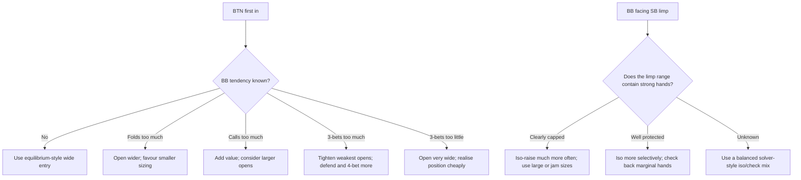

# Heads-Up No-Limit Hold'em Preflop Strategy: Complete Reference

*Compiled 6 November 2026. Merges two independent research reports and a comparison of them into one document, organised by topic.*

---

## 0. How to read this document

### 0.1 Provenance tags

Every claim is tagged with where it came from:

| Tag | Meaning |
|---|---|
| **[R1]** | Report 1: Claude's research report, *"Optimal Heads-Up No-Limit Hold'em Preflop Strategy: A Solver-Backed Guide"* |
| **[R2]** | Report 2: the second research report, *"Optimal Heads-Up No-Limit Hold'em Preflop Strategy"* (executive summary + playbook format) |
| **[Both]** | Stated in both reports |
| **[Analysis]** | Derived from comparing the two reports, or a correction made while compiling |

### 0.2 Evidence grades

- **Solver-backed:** the number comes from a published equilibrium solve with stated settings.
- **Heuristic:** coaching guidance, a simplification, or reasoning derived from solver logic.
- **Empirical:** observed results from real matches or bot challenges.

### 0.3 Default assumptions

Unless a row says otherwise:
- **Game:** No-Limit Texas Hold'em, two players.
- **Blinds:** the button posts the small blind (SB, 0.5bb) and acts first preflop and last postflop. The big blind (BB) posts 1bb.
- **Reading frequencies:** exact numbers depend on rake, antes, the allowed bet sizes (the "tree"), the solver, and convergence. Treat any single percentage as one point in a band, not a law. **[Both]**

### 0.4 Glossary

| Term | Meaning |
|---|---|
| **GTO / Nash equilibrium** | A strategy pair where neither player gains by changing their own strategy alone |
| **Tree** | The set of actions and bet sizes a solver is allowed to use |
| **VPIP** | Percentage of hands where a player voluntarily puts money in (limp or raise) |
| **MDF** | Minimum defence frequency: how often you must continue so the opponent's bluff isn't automatically profitable |
| **EQR** | Equity realisation: the share of your raw equity you actually capture postflop. EQR = pot share ÷ equity |
| **Iso / isolation raise** | The BB raising after the SB limps |
| **Polar range** | Strong hands plus bluffs, few medium hands |
| **Linear / merged range** | The top X% of hands, played the same way |
| **Capped range** | A range with no strong hands left in it, because they were played another way |
| **Nodelock** | Fixing one player's strategy in a solver and letting the solver compute the best counter |
| **Chip-EV** | Expected value counted in chips, without tournament payout effects |
| **ICM** | Independent Chip Model: converts tournament chip stacks into prize-money equity |
| **Risk premium** | The extra equity ICM requires above chip-EV before you call or commit |
| **SPR** | Stack-to-pot ratio |
| **bb/100** | Big blinds won per 100 hands |
| **mbb/hand (or mbb/g)** | Milli-big-blinds per hand. 1 mbb/hand = 0.1 bb/100 |
| **SC numbers** | Sklansky-Chubukov numbers: the largest stack at which shoving beats folding even if the opponent can see your cards |

---

## 1. Executive summary

### 1.1 The one-paragraph answer

At 100bb, the button/SB plays about **80–96%** of hands, mostly as a **2–2.5bb open** with a smaller **limp** share. The BB defends about **60–80%** against that open and **3-bets aggressively (about 17–25%)**. As stacks shrink, the SB folds even less, limps more, and below about **10–12bb** switches to **limp/jam** or **shove/fold**. **[R1]**

Heads-up differs from 6-max because the button is also the SB. It acts first preflop but is in position on every postflop street. That makes folding the button too often one of the largest systematic preflop errors in heads-up. **[R2]**

### 1.2 The benchmark solve, and why it appears in both reports

**Source:** SolvePoker's MonkerSolver heads-up cash solve: 100bb, 5% rake capped at 2bb, about 1.6 trillion iterations. **[Both]**

| Spot | Action | Frequency |
|---|---|---|
| SB first in | Raise to 2.5bb | **69.1%** |
| SB first in | Limp | **17.1%** |
| SB first in | Fold | **13.8%** (total VPIP 86.2%) |
| BB vs 2.5bb open | 3-bet to 10bb | **24.6%** |
| BB vs 2.5bb open | Call | **33.8%** |
| BB vs 2.5bb open | Fold | **41.6%** |
| BB vs limp | Raise to 3.5bb | **41.6%** |
| BB vs limp | Check | Remainder (58.4%) |

**[Analysis]** Both reports quote this same solve. Their agreement is therefore one data point, not two independent confirmations. Neither report found a published 100bb heads-up solve **without rake** that gives full frequencies.

### 1.3 Core conclusions

1. **The SB is the widest seat in poker.** It plays over 80% of hands at 50–100bb in every credible solve. **[Both]**
2. **Limping is part of equilibrium heads-up,** unlike in full-ring. It becomes the main SB action from about 35bb down to 10bb. **[R1]**
3. **The BB defends far wider than in 6-max,** where BB vs BTN is about 45% defence with about 13% 3-bets. Heads-up figures are about 58% (raked, 100bb), about 70% (100bb, ante) and about 80% (40bb, ante), with 3-bet or jam frequencies of 18–25%. **[R1]**
4. **There is no universal chart.** Ranges change with rake, allowed open sizes, whether limping is allowed, 3-bet and 4-bet sizes, stack depth, antes and postflop abstraction. **[Both]**
5. **How many hands you play is more stable than how you play them.** Different solvers mostly agree on total VPIP. They disagree on which hands raise and which limp. **[R2]**
6. **Exploit only on evidence.** Deviate when you can identify which part of the opponent's range is misallocated. **[Both]**

### 1.4 Default sizing conventions at 100bb

| Action | Size | Source |
|---|---|---|
| SB open | 2–2.5bb (2.5bb in raked cash) | [Both] |
| BB 3-bet | About 4x the open (10bb vs 2.5bb) | [R1] |
| SB 4-bet (in position) | About 2.2–2.5x the 3-bet (about 22bb) | [R1] |
| 5-bet | All-in | [R1] |

---

## 2. Game-theory foundation and evidence quality

### 2.1 What "GTO" means here

- **Definition:** a GTO strategy is an approximate Nash equilibrium. Neither player can improve expected value by changing strategy alone while the opponent plays the equilibrium. **[R2]**
- **Guarantee:** in a two-player zero-sum game, an equilibrium strategy cannot lose in expectation once you average over both seats. Maximal exploits, by contrast, open you up to counter-exploitation. **[R1]**
- **Model dependence:** "solver GTO" means equilibrium **within a specified model**. It is not proven equilibrium of unrestricted real HUNL. Three things cause the gap: **[R2]**
  - Bet-size abstraction can leave out profitable actions.
  - Card abstraction can merge hands that should be played differently.
  - Convergence tolerances leave some residual exploitability.
- **Measuring solution quality:** PioSOLVER reports exploitability per hand. MonkerSolver uses configurable abstraction to keep large games tractable. **[R2]**

### 2.2 Algorithms

- **CFR (Counterfactual Regret Minimisation):** introduced by Zinkevich, Johanson, Bowling and Piccione. They showed that minimising counterfactual regret converges towards Nash equilibrium, which made very large poker abstractions computationally tractable. **[R2]**
- **CFR+:** the variant used by Cepheus. **[Both]**

### 2.3 Landmark systems

| System | Game | Key result | What it means for preflop | Source |
|---|---|---|---|---|
| **Cepheus** | Heads-up **limit** hold'em | Essentially weakly solved with CFR+. Bowling et al., *Science* 2015: after **1,579 iterations / 900 core-years**, exploitability of **0.986 mbb/g**. Initially raises **82.54%** and calls only **0.06%** (2018 *Frontiers in Psychology* commentary) | Confirms the button's positional advantage and very wide first-in raising. **Not** a heads-up NLHE chart, because the betting game is different | [R1] numbers; [R2] framing |
| **DeepStack** | HUNL | Continual re-solving with CFR-style reasoning and learned value functions; beat professionals over a **44,000-hand** experiment | Strong HUNL play comes from equilibrium reasoning and re-solving; no static chart published | [R2] |
| **Libratus** | HUNL | Beat four elite heads-up specialists over **120,000 hands** by **147 mbb/hand (14.7bb/100)** at **99.98%** statistical significance | Same as above. Brown & Sandholm note HUNL has **10^161 decision points**, so every practical solution is an approximation | [Both] |
| **Pluribus** | **6-max** NLHE | Brown & Sandholm, *Science* 2019: confirms limping is suboptimal **except from the SB**, which only has to invest half as much as the others to call | Supports heads-up SB limping **qualitatively**. Its frequencies don't transfer to heads-up. Third-party claims that it "limps 50/50" are unofficial reverse-engineering | [R1] |
| **GTO Wizard AI** | HUNL | Beat Slumbot by **19.4bb/100** | Shows the size of edges between near-equilibrium bots | [R1] |
| **PokerSnowie** | HUNL and others | Neural network trained through continuous self-play (not classical CFR). Interface shows a 169-hand preflop matrix with raise/call/fold frequencies and optional rake removal | An independent AI baseline, not canonical solver truth. See Section 13 | [R2] |

---

## 3. Solver tool landscape

Not every tool that is called a "solver" solves preflop. **[R2]**

| Tool | Solves preflop equilibrium? | Relevant capability | How to interpret its output |
|---|---|---|---|
| **PioSOLVER 3 Edge** | **Yes** | Edge includes a heads-up preflop solver. Pio Pro is mainly flop/turn/river | Good for custom heads-up preflop trees. Results depend on tree, rake and convergence |
| **GTO+** | **No full-game preflop solver** | Nash solver for heads-up **postflop** games. Its preflop menu edits and imports starting ranges | A GTO+ starting range is not preflop-solved unless it came from an outside solve |
| **Simple Postflop** | **No** (postflop only) | Postflop solving | The same company's **Simple Preflop Holdem** is the preflop engine: 2–10 players, chip-EV or ICM, optional rake |
| **MonkerSolver** | **Yes** | Solves Hold'em or Omaha from any street with any number of players and configurable trees | Source of the main public heads-up preflop dataset (the SolvePoker solve) |
| **GTO Wizard** | Yes (precomputed libraries plus custom heads-up solving) | Custom stacks, antes, rake and bet sizes. "Simple" solutions do **not** allow SB limps | Blog studies supply most of the nodelock and short-stack data in this document |
| **HoldemResources (HRC)** | Yes (push/fold Nash and ICM) | Push/fold charts and per-hand thresholds, with and without antes | Exact for the **restricted** push/fold game |

### 3.1 Simple Poker's heads-up library **[R2]**

- **Depths covered:** 50bb, 100bb, 150bb and 200bb.
- **Alternative 100bb trees:** 2x open, 3x open, and 3x open with limping allowed.
- **Free 100bb library settings:** solved in Simple Preflop Holdem with 10k/100k/100k postflop buckets and **no rake**; postflop then solved in Simple Postflop.
- **Why this matters:** the switch from no rake to the Monker solve's 5% rake is enough on its own to move marginal hands and mixed frequencies.

### 3.2 Inputs each tool needs **[R2]**

| Tool | Required or configurable inputs |
|---|---|
| Pio | Starting pot, stacks, ranges, bet sizes |
| Simple Preflop | Rake; chip-EV or ICM model |
| Monker | Fully custom betting trees |
| GTO Wizard | Custom stacks, antes, rake, bet sizes |

---

## 4. Strategy by effective stack depth

### 4.1 Master table: solver-backed numbers at each depth **[R1]**

| Depth | SB first in | BB vs open | BB vs limp | Source and settings |
|---|---|---|---|---|
| **100bb cash** (5% rake, 2bb cap) | Raise 2.5bb **69.1%**, limp **17.1%**, fold **~13.8%** | 3-bet to 10bb **24.6%**, call **33.8%**, fold **~41.6%** | Raise to 3.5bb **41.6%**, check the rest | SolvePoker / MonkerSolver |
| **100bb MTT** (chip-EV, 0.25bb ante) | Fold **≤4.1%**, limp **35–41%**, raise the rest | Fold **29.7%** | Raise **34–37%** (from 60bb up), never jam | Poker Academy heads-up MTT charts |
| **60bb** (0.25bb ante) | Raise 2.3bb **61.5%**, limp **34.6%**, fold **4.0%** | — | Raise **34–37%** | Poker Academy |
| **50bb** (chip-EV, 0.12bb ante) | Raise **~64%**, fold **4%**, limp the rest (~32%) | 3-bet to **~8.4bb** (vs ~2.1bb open) | Raise **34%** (to ~6bb) | GTO Wizard heads-up blog |
| **40bb** (0.25bb ante) | Raise 2.2bb **53.1%**, limp **43.7%**, fold **3.2%** | Call **56.5%**, 3-bet to 6.9bb **17.6%**, jam **6.0%**, fold **19.9%** | — | Poker Academy |
| **20bb** (0.25bb ante) | Limp **73.0%**, raise 2bb **24.9%**, jam **1.1%**, fold **0.9%** | Jam **18.5%**, small 3-bet **9.4%**, fold **19.0%** (call ~53.1%) | — | Poker Academy |
| **15bb** (0.25bb ante) | Limp **82.7%** | — | — | Poker Academy |
| **10bb** (0.25bb ante) | Limp **61.1%**, jam **28.8%**, fold **10.1%** | vs jam: call **40.5%** | Jam **35.2%**, raise 2.5bb **15.2%**, check **49.5%** | Poker Academy |
| **10bb** (no ante) | VPIP **~88%**, open-jam **~22%**, most of the rest limps | — | — | GTO Wizard short-stack heads-up |
| **8bb** (0.25bb ante) | Jam **48.7%**, fold **21.2%**, limp the rest (~30.1%) | — | — | Poker Academy |

Other points from Poker Academy:
- From 12.5bb up, the button folds **4.1% of hands or less**. **[R1]**
- The limp share falls to **35–41% from 50bb up** and rises steeply below that. **[R1]**
- **"Never limping"** is a common mistake, because limping is the most common button play **from 10bb to 35bb**. **[R1]**

**[Analysis]** The two 10bb rows agree. With a 0.25bb ante, VPIP is about 89.9% with 28.8% jams. Without an ante, VPIP is about 88% with about 22% jams. The ante explains the higher jam share.

### 4.2 Summary table by depth band **[R2]**

| Effective stack | Button/SB default | BB default | Main strategic change |
|---|---|---|---|
| **200bb** | Enter about as wide as at 100bb. Prefer small raises, plus protected limps if the tree allows them | Defend selectively but keep suited and connected hands; avoid excessive preflop stack-offs | Suitedness, nut potential and position gain value; 4-bet and 5-bet all-ins become rarer |
| **100bb** | Benchmark: raise 69.1%, limp 17.1%, fold 13.8% (Monker solve) | vs 2.5x: 3-bet 24.6%, call 33.8%, fold 41.6% | Richest mix of calls, raises and reraises |
| **50bb** | Total entry similar to 100bb, but speculative implied-odds hands are worth less | More aggressive 3-betting; fewer purely speculative calls | Lower SPR increases the value of high cards and immediate equity |
| **20–40bb** | Mix of limp, min-raise and jam; do **not** reduce the game to pure push/fold | 3-bet jams and large iso-raises become increasingly important | Equity realisation and fold equity dominate implied odds |
| **≤10bb** | Limp/jam, then push/fold, become dominant | Call-off thresholds and responses to jams become central | Preflop all-in play approaches a solvable push/fold subgame |

### 4.3 Deep stacks (100–200bb)

- **Stability:** opening ranges change little between 50bb and 200bb. SolvePoker says a 100bb chart is fine for most deep-stack cash. **[Both]**
- **What deeper stacks favour:** suitedness, nut-flush potential, connectivity, positional play and postflop flexibility. They make marginal preflop stack-offs less attractive. Solver material shows fewer all-ins and more value for suited connectors as stacks get deeper. **[R2]**
- **At 200bb, don't just double 100bb aggression:** **[R2]**
  - Use smaller 4-bets relative to the pot.
  - Keep calling with playable suited hands.
  - Be more selective about stacking off with hands that are mostly one pair.
- **At 50bb, the reverse:** implied odds shrink, raw high-card equity matters more, and 3-bet and jam branches become more relevant. **[R2]**
- **Caveat:** these are directions, not exact numbers. Exact percentages need a solve with the real rake and tree. Simple Poker and Monker publish separate solves at these depths because one 100bb output is not exact for every stack. **[R2]**

### 4.4 Medium stacks (25–60bb) **[R1]**

- **Limps:** the limp share grows as stacks shorten.
- **BB 3-bets:** start to include jams around 40bb.
- **Open sizes:** raise trees use smaller sizes (2–2.3bb).
- **40bb hand detail (Poker Academy):**
  - KQs, AJo and ATo **limp most of the time**, so the BB can't raise every limp for free.
  - BB 3-bets are mostly strong aces, broadways and pairs 66+, plus a few small suited connectors (76s, 65s).
  - BB jams are led by AQo, AJo and the small pairs.
  - BB's needed equity with the ante: **25.8%**.

### 4.5 Short stacks (15–25bb)

**SB:**
- Limps most of its range. The raise is a min-raise (2bb). **[R1]**
- **Report 1 view (Poker Academy, 20bb, 0.25bb ante):** the raise range is **split**. It contains premiums (AA, KK, AKs, AQs) plus weak suited hands (94s, 84s, 73s, 42s) that would rather not see a cheap flop. The middle of the range limps. **[R1]**
- **Report 2 view (GTO Wizard, 20bb, no ante):** high-equity hands mostly min-raise, middle-equity hands mix limps and raises, and low-equity hands mostly limp. **[R2]**
- **These views disagree.** See Section 15.4.

**BB:**
- Its main weapon against opens is the **jam**. **[R1]**
- Against limps it uses small isos, large isos and all-in isos. Medium and low offsuit Ax and small pairs are natural jam candidates: they have a lot of immediate equity but realise it awkwardly postflop. **[R2]**
- At shorter depths, all-in makes up **about 22%** of BB isolations (GTO Wizard). **[R1]**

**From 20bb to 16bb:** the SB's min-raise frequency falls and the BB uses larger isolations more often. **[R2]**

**[R2] conclusion:** even at 20bb the equilibrium is a multi-action game. "20bb = push/fold" is far too crude.

### 4.6 Push/fold territory (below about 12–15bb)

- **SB options:** collapse to limp, jam or fold. **[R1]**
- **Traps at 10bb (Poker Academy, 0.25bb ante):** **AA, KK and AK limp 100%** to trap the BB's jams. **[R1]**
- **What jams at 10bb:** the middle of the range, such as offsuit aces, offsuit kings and 22–44. **[R1]**
- **Pure push/fold:** a slightly weaker approximation, but simple and robust. **[R1]**
- **Report 2 summary:** even at 10bb, a protected limp range can remain theoretically important when limping is allowed. **[R2]**
- **HRC's warning:** its Nash charts are for a **restricted** game. Use pure push/fold only up to about **10bb**. Using it above 20bb is almost certainly a bad idea. **[Both]**

---

## 5. Nash push/fold reference

### 5.1 Nash frequencies (SB shove-or-fold vs BB call-or-fold, no ante)

These are solver-backed for the simplified game. Sources differ by a few percentage points because they simplify differently. **[R1]**

| Effective stack | SB shove % | BB call % |
|---|---|---|
| 5bb | ~71–72% | ~62% |
| 8bb | ~57–62% | ~40–45% |
| 9bb | 58.7% | 42.7% |
| 10bb | 52.9–58.9% | 34.2–38.5% |
| 12bb | 47.8–51.4% | 30–33% |
| 15bb | ~41–45% | ~25–29% |
| 20bb | ~36–40% | ~20–22% |

**What each source gives at 10bb:**
- pailiku heads-up Nash solver: 52.9% shove / 34.2% call.
- Poker Level Up solver: about 58% shove / 38% call.
- PokerStrategy Nash tables: 56.6% shove / 38.5% call.

### 5.2 Example Nash ranges (PokerStrategy) **[R1]**

| Stack | Action | % | Range |
|---|---|---|---|
| 9bb | BB call | 42.7% | 22+, Ax+, K2s+, K4o+, Q4s+, Q8o+, J7s+, J9o+, T8s+, T9o, 98s |
| 10bb | SB shove | 56.6% | 22+, Kx+, Q2s+, Q7o+, J3s+, J8o+, T5s+, T8o+, 95s+, 97o+, 85s+, 87o, 74s+, 64s+, 53s+ (all Ax included) |
| 10bb | BB call | 38.5% | 22+, Ax+, K2s+, K6o+, Q6s+, Q8o+, J8s+, J9o+, T9s |
| 12bb | BB call | 33.0% | 22+, Ax+, K4s+, K8o+, Q8s+, Q9o+, J9s+, JTo |

### 5.3 HoldemResources per-hand thresholds **[R1]**

This is the most useful format for a bot. Each hand has a maximum stack at which it shoves or calls.

| Hand | No ante: shove up to | No ante: call up to | 10% ante |
|---|---|---|---|
| K2o | 11.6bb | 8.1bb | — |
| Q2o | 7.0bb | 5.6bb | Shove up to 8.1bb |
| T3s | 7.7bb | — | — |
| A2o | — | 15.8bb | Call up to 18.1bb |
| 22 | — | 15.0bb | — |
| J2o | 4.6bb | — | Shove up to 5.5bb |
| 63s | 5.1–7.1bb, and below 2.3bb (a gap) | — | — |

- **Gaps:** some hands shove at two separate stack ranges, like 63s above. **[R1]**
- **Mixing:** most hands play a mixed strategy for at least a few stack sizes. **[R1]**
- **Antes:** every threshold rises with a 10% ante. Several weak suited kings, queens and jacks stay profitable shoves at deeper stacks than in the no-ante solution. **[Both]**
- **No ante, 20+bb pusher chart:** every Ax and nearly every Kx shoves. **[R1]**

### 5.4 Sklansky-Chubukov numbers **[R1]**

- **What they measure:** the largest stack at which shoving beats folding **even if the BB sees your cards**. This makes them a conservative floor, not an equilibrium.
- **Examples:**
  - AKo is about **332**, in the original units where SB + BB = 3.
  - **19 hands** reach the 50bb ceiling of the published table: pairs 66+, ATo+, A9s+ and KQo.
- **[Analysis] Likely typo:** a suited hand always ranks at least as high as its offsuit version. So "KQo" here probably should read **KQs** (the count of 19 is the same either way). Check the PrimeDope table before relying on it.
- **Relation to Nash:** Nash thresholds are higher than SC for most hands, because the real caller can't see your cards.

---

## 6. Button/SB strategy

### 6.1 How often to play **[R1]**

| Setting | SB folds | SB VPIP |
|---|---|---|
| Raked cash, 100bb | ~14% | ~86% |
| Chip-EV or ante games, 50–100bb | ~4% | ~96% |

- **What folds:** the worst offsuit hands, such as 32o, 42o, 72o and 82o. In raked games, more weak offsuit gappers fold too.
- **Why so wide [R2]:**
  - The SB risks little to attack 1.5bb of blinds.
  - It faces only one opponent.
  - It is in position whenever it gets called.

### 6.2 Upswing's practical heuristics (raise-only, deeper than 40bb) **[R2]**

| Open size | Suggested opening range |
|---|---|
| 2x–2.25x | 90%+ |
| 2.5x | 80–90% (readless default **~85%**) |
| 3x | 70–80% |

- **Sizing rule:** larger opens mean tighter ranges.
- **Adjustments:** widen against tight BBs; tighten against opponents who defend and 3-bet aggressively.

### 6.3 Reconciling raise-only charts with solver output **[R2] + [Analysis]**

- **Solver split:** the Monker solve splits the SB's 86.2% VPIP into 69.1% raises and 17.1% limps.
- **Heuristic total:** Upswing's ~85% total entry is almost the same total, even though one raises everything and the other doesn't.
- **Lesson:** total range width is more stable than the raise/limp split. A solve without limping must move the would-be limps into raises or folds. So two "GTO charts" can disagree on whether Q7o, 65s or a small pair should raise or limp, while agreeing that the hand should be played.
- **Correction to Report 1:** Report 1 dismissed "90–100% raise" charts as conflicting with the solves. That is fair only for trees where limping is allowed. In a raise-only tree, a raise frequency of 85–90% at small sizes is consistent with the solves.

### 6.4 Open sizing

- **Solver-backed defaults [R1]:**

| Depth | Open size | Source |
|---|---|---|
| 100bb | 2.5bb | SolvePoker / Monker |
| 60bb | 2.3bb | Poker Academy |
| 40bb | 2.2bb | Poker Academy |
| 20bb | 2bb | Poker Academy |

- **Effect of a larger open (3.5bb), per GTO Wizard [R1]:**
  - The SB moves even more of its range into limps and polarises its raises.
  - The BB folds more and 3-bets a stronger range.
- **Heuristic [R1]:** use 2.5bb in raked 100bb cash, because rake rewards winning preflop. Use 2–2.2bb in ante or tournament games. Go smaller as stacks get shorter.

### 6.5 Limping vs raising **[R1]**

**Limps are part of the equilibrium, not a leak:**
- The limp range is **mixed rather than capped**. At 40bb, KQs, AJo and ATo limp most of the time, so the BB can't raise every limp for free.
- At 10bb, the premiums limp to trap the BB's jams.
- GTO Wizard's ante-cash study: antes make limping the SB's main continuing action, even in 6-max.

**Cost of dropping limps:**
- GTO Wizard's "Simple" solutions don't allow SB limps.
- **At 100bb:** pure raise/fold is a reasonable simplification with slightly lower EV.
- **At tournament depths (≤35bb):** dropping limps is a much larger error.

**Solvers disagree on the 100bb limp share:**

| Source | Limp share at 100bb |
|---|---|
| Raked MonkerSolver | 17% |
| Open-source raked solve | 22% |
| 0.25bb-ante MTT charts | 35–41% |

Antes push the limp share up; rake pushes it down.

---

## 7. BB strategy vs SB opens

### 7.1 Price and MDF (no rake, no ante) **[R1]**

| SB open | BB calls | Final pot | Equity BB needs | SB risk : reward | SB auto-profit if BB folds more than | BB minimum defence (MDF) |
|---|---|---|---|---|---|---|
| 2.5bb | 1.5bb | 5bb | **30%** | 2bb : 1.5bb | 57.1% | **42.9%** |
| 2bb (min-raise) | 1bb | 4bb | **25%** | 1.5bb : 1.5bb | 50% | **50%** |

- **Why the BB defends more than MDF:** it actually defends 58–80%. Almost every hand has 30%+ raw equity against an SB range wider than 70%.
- **The real constraint is equity realisation out of position:**
  - Threshold equity = needed equity ÷ EQR.
  - EQR = pot share ÷ equity (GTO Wizard's definition).
  - A larger SB open lowers the BB's realisation, so the BB tightens.
- **Ante example:** Poker Academy's 40bb example gives a needed equity of 25.8%.

### 7.2 Comparing defence numbers across solves **[R2]**

- **Why not to compare directly:** in the Monker tree, the SB's raises are only part of its first-in strategy; the weaker hands limp. So the BB is defending against a **stronger** raising range than in a raise-only tree.
- **Consequence:** don't compare the 41.6% fold figure with a solve where the SB raises 85–95% and never limps.
- **Rule:** widen the BB's defence against a much wider raise-only SB.
- **Sizing matters:** a 2x open gives the BB much better odds than a 3x open, so defence widens as the open shrinks.

### 7.3 3-bet frequency **[R1]**

| Setting | BB 3-bet % |
|---|---|
| 100bb raked (to 10bb) | 24.6% |
| Open-source raked solve | ~25% |
| 40bb with ante | 17.6% plus 6.0% jams |
| 6-max BB vs BTN, for comparison | ~13% |

### 7.4 3-bet range shape

**Against a wide SB, the range is fairly linear to merged [R1]:**
- Strong broadways and offsuit high cards that dominate the SB's offsuit kings and queens 3-bet rather than call.
- Low suited hands and offsuit connectors fill out the bottom.
- The BB mixes in weaker offsuit face cards that block part of the SB's 3-bet calling range (GTO Wizard).

**Shape that holds across models [R2]:**

| Region | Hands |
|---|---|
| Value 3-bets | Premium pairs, strong Ax, broadways |
| Bluffs and semi-bluffs | Blocker hands and suited hands |
| Calls | Medium-equity hands that realise well |
| Folds | The weakest disconnected offsuit hands |

### 7.5 3-bet sizing **[R1]**

| Setting | BB 3-bet size |
|---|---|
| 100bb, out of position | ~4x the open (10bb vs 2.5bb) |
| 50bb solve (GTO Wizard) | ~8.4bb vs a ~2.1bb open; ~7.4bb as an exploit against an overfolder |
| Below ~25bb | The 3-bet becomes a jam |

### 7.6 BB vs a limp **[Both]**

**The BB never folds after a limp. Raise frequencies [R1]:**

| Depth | BB raises | Other actions |
|---|---|---|
| 100bb raked | 41.6% to 3.5bb | Check the rest |
| 100bb with ante (from 60bb up) | 34–37% | Never jams |
| 50bb | 34% to ~6bb | Check the rest |
| 10bb | Raises small 15.2% | Jams 35.2%, checks 49.5% |

**Range construction:**
- The raise range is **polarised**: premiums plus junk offsuit hands that play badly after a check. **[R1]**
- Raise strong hands plus enough middling and bluff hands to reach a very wide isolation range. **[R2]**
- Check hands that want to realise equity cheaply or that do badly against a limp-reraise. **[R2]**

---

## 8. 3-bet, 4-bet and 5-bet dynamics

### 8.1 Sizing conventions at 100bb **[R1]**

| Source | 3-bet | 4-bet | 5-bet |
|---|---|---|---|
| Open-source raked heads-up solve | 10bb | 22bb or 30bb | All-in |
| Simple Preflop cash bundle | — | 2.3x in position, 2.75x out of position | All-in at 100bb |
| General solver trees | ~10bb (vs 2.5bb open) | ~22bb (~2.2–2.3x in position) | All-in |

### 8.2 SB facing a 3-bet

- **Calls widely,** because it is in position. **[R1]**
- **4-bets a polarised range [R1]:**
  - Value: QQ+, AK.
  - Blockers: A5s–A2s, some suited Kx.
- **4-bet frequency (DEEPFOLD estimate, heuristic) [R1]:**
  - Heads-up SB facing a BB 3-bet: about **10%** (about 6% value, 4% bluff).
  - 6-max BTN vs BB, for comparison: about **5%**.
- **Against aggressive 3-bettors [R2]:**
  - Stop opening hands whose EV mainly comes from seeing a cheap flop.
  - Protect the range with more calls and 4-bets.
  - Let the opening frequency fall.

### 8.3 5-bets and jams **[R1]**

- **At 100bb, any 5-bet is effectively all-in.**
- **Price of calling a jam after 4-betting to 20–25bb:** about **37–40%** equity.
  - Worked example: 4-bet to 22bb, BB jams 100bb. The SB calls 78bb into a final pot of 200bb, so it needs 78/200 = 39%.
- **Who does what after the jam:**
  - 4-bet bluffs (A5s and similar) fold.
  - The value region (QQ+/AK, plus JJ/TT/AQs mixes against aggressive 3-bettors) gets it in.
- **Heuristic (888poker):** the heads-up BB 5-bet jams strong premiums, TT+ and AQs+.

### 8.4 When to jam instead of a sized raise **[R1]**

- **Trigger:** once the SPR after a 3-bet falls below about 1, which is roughly **25bb or less** effective.
- **Solver behaviour:** small 3-bets are replaced by jams.
- **Example:** at 20bb, Poker Academy's BB jams **18.5%** vs **9.4%** small 3-bets.
- **Report 2 framing:** at 200bb, 4-bet and 5-bet all-ins become rarer and 4-bets get smaller relative to the pot. At 50bb, 3-bet and jam branches become more relevant. **[R2]**

---

## 9. Rake, antes, ICM, tournament vs cash

### 9.1 Rake (cash games)

**How rake changes play (Andrew Brokos, GTO Wizard) [R1]:**
- **Fewer hands:** in raked games, players facing a raise play **25–35% fewer hands**.
- **Calling hit hardest:** rake isn't collected from pots that end preflop ("no flop, no drop"). So players actually **3-bet more** in raked games.
- **BB vs min-raise:** the BB calls a min-raise only about **60% as often** as in an unraked game.
- **Summary:** as rake rises, ranges tighten but are played more aggressively.

**Effect in heads-up [R1]:**

| Effect of rake | Raked | Ante / chip-EV |
|---|---|---|
| SB folds | ~14% | ~4% |
| BB folds vs open | ~42% | 20–30% |

- The BB keeps a high 3-bet share under rake.
- Rake slightly favours larger SB opens, because winning preflop avoids the rake.
- Heads-up rake is usually lower than 6-max rake. Low-stakes heads-up with high caps behaves like the raked numbers; lower rake moves you towards the chip-EV numbers.

### 9.2 Antes

**Dead money widens everything [R1]:**
- GTO Wizard's ante-cash study: the SB folds only **33%** with an ante vs **54%** without one, and limping becomes the main SB action.
- HRC's 10%-ante push/fold thresholds are all higher. Example: J2o shoves up to 5.5bb with the ante vs 4.6bb without.

**Report 2's ante adjustment table [R2]:**

| Change | BTN/SB adjustment | BB adjustment |
|---|---|---|
| Add antes | Enter more hands; marginal limps, raises and jams gain value | Defend and call jams somewhat wider |
| Remove antes | Tighten marginal entries | Require stronger equity for marginal calls |
| Raise the ante relative to the stack | Treat the game as effectively shallower | Weight immediate fold equity more |

**Ante formats are not interchangeable [R2]:**
- A 0.1bb ante from each player, a big-blind ante, and a 0.125bb-per-player structure create different pot geometry.
- HRC publishes no-ante and 10%-ante models; other packs use other conventions.
- Don't transfer ranges between formats blindly.

### 9.3 ICM

**Heads-up, ICM is linear [Both]:**
- With exactly two players left, prize equity = P2 + (P1 − P2) × chip share.
- Under the Malmuth–Harville model, both players have locked up second place and play only for the difference between first and second.
- So every chip is worth the same, and chip-EV ranges (Nash push/fold, Poker Academy's charts) are directly correct.

**Blind vs blind with 3+ players left (Brokos, GTO Wizard) [R1]:**
- **SB under rising risk premium:** opens less, and reaches an almost pure **limp-or-fold** strategy under extreme pressure (bubble, nine-handed final table).
- **SB at 20bb:** shifts towards shoves and folds.
- **BB:** keeps a solid raising range even under intense ICM pressure, because position improves its equity realisation.
  - Example: with a risk premium of about 11–12%, the BB still raises limps **28–35%**.
- **Calls against shoves:** tighten in proportion to the risk premium. In GTO Wizard's ICM basics example, a player needed an extra **12 percentage points** of equity beyond the chip-EV threshold.

### 9.4 Tournament vs cash **[R2]**

**Why ranges still differ once ICM drops out:**

| Factor | Tournaments | Cash games |
|---|---|---|
| Antes | Often | Rarely |
| Rake | None | Often meaningful |
| Stacks | Shorter | Deeper effective stacks |
| Blinds | Change over time | Fixed |

- **Bounty formats** can create non-standard prize incentives.
- **PokerSnowie** treats freezeout and cash training separately and has ante/no-ante and rake/no-rake settings, because these parameters change the evaluation.

---

## 10. Hand-class insights

| Hand class | Behaviour | Source |
|---|---|---|
| **Suited and connected hands** | Gain value with depth (implied odds, playability in position). Main beneficiaries of the SB's position and the BB's cheap defence price. At 20bb, weak suited hands even become raise-or-fold "bluff" opens (Poker Academy) | [R1]; deep-stack value [R2] |
| **Offsuit aces and kings** | The **core** shoving hands in shove/fold games. Nash calls Ax with any kicker at 9–12bb. HRC's no-ante pusher chart shoves every Ax and nearly every Kx at 20+bb. Their value comes from blocking and raw high-card equity, not playability | [R1] |
| **Medium/low offsuit Ax and small pairs (BB vs limp, ~20bb)** | Natural jam candidates: lots of immediate equity, awkward postflop realisation | [R2] |
| **Small pairs** | Jams at 10bb (22–44 jam per Poker Academy). At 100bb, mostly calls or limps for set value. Related 6-max BB vs BTN data: 77 goes from a pure call at 100bb to a **39%** 3-bet at 50bb | [R1] |
| **Blockers** | A5s–A2s are standard 3-bet and 4-bet bluffs. They block AA, AK and AQ (the opponent's continuing range) and keep wheel and flush playability. Offsuit face cards that block the SB's 3-bet calling hands enter the BB's 3-bet range | [R1] |
| **Premiums at short stacks** | AA, KK and AK limp 100% at 10bb (0.25bb ante) to trap jams | [R1] |
| **Offsuit Ax/Kx vs a capped limp range** | The BB's isolation frequency with these rises sharply when the SB raises all its strong hands | [R2] |

### 10.1 Mixed strategies **[R1]**

- **Mixes are real:** SolvePoker stresses that a half-filled cell means the solver raises that hand half the time. Playing it pure in either direction is a leak.
- **They are common:** HRC notes that most hands play a mixed strategy for at least a few stack sizes.
- **For a bot:** use per-hand probabilities, not just thresholds.
- **For a human:** playing mixed hands with a pure strategy costs little EV, as long as the overall frequencies are right.

---

## 11. Practical baselines

### 11.1 Simplified 100bb hand-class baseline **[R2]**

**Assumptions:**
- Heads-up cash, about 100bb, 2.5bb button open, no ante.
- Rake similar to the Monker solve.

**Caveats:**
- This is a human-usable simplification; not every listed hand is pure in every solver.
- Randomise boundary hands, or move them exploitatively.
- **[Analysis]** These categories are too vague to play hand by hand. Use them with the per-depth frequencies in Section 4 and the push/fold ranges in Section 5.

| Spot | High-frequency action | Hand-class rule |
|---|---|---|
| BTN first in | Raise | All premiums; all pairs; almost all Ax; strongest Kx/Qx/Jx; most suited hands; connected and one-gap hands |
| BTN first in | Limp or mix | Medium-strength suited hands, weaker offsuit broadways and high cards, and some hands whose EV is protected by playing in position |
| BTN first in | Fold | The bottom ~14%: mainly weak disconnected offsuit hands |
| BB vs 2.5x | 3-bet | Premiums plus strong broadways and high cards, then selected blocker and suited semi-bluffs |
| BB vs 2.5x | Call | Medium pairs, suited hands, connected cards, and offsuit hands that realise enough equity |
| BB vs 2.5x | Fold | The weakest disconnected offsuit region |
| BB vs BTN limp | Raise often | Strong hands plus enough middling and bluff hands to make a very wide isolation range |
| BB vs BTN limp | Check | Hands that benefit from realising equity cheaply, or that do badly against a limp-reraise |

Frequency targets for this baseline: **69.1/17.1/13.8** BTN raise/limp/fold, and **24.6/33.8/41.6** BB 3-bet/call/fold.

### 11.2 Report 2's practical playbook **[R2]**

| Situation | Recommended simplified policy |
|---|---|
| 200bb BTN | Play about the same broad hand set as 100bb; prioritise suitedness and connectivity; avoid excessive preflop stack-offs |
| 100bb BTN | Target ~85–87% VPIP; a balanced version is about 70% raise / 15–20% limp / 10–15% fold |
| 50bb BTN | Stay very wide but drop the weakest speculative hands; lean slightly more to raising than limping if the opponent doesn't punish opens |
| 40bb BTN | Add more min-raises and prepare for 3-bet jams; small pairs and weak suited connectors lose some implied-odds value |
| 20bb BTN | Keep VPIP very high; split the range across limp, min-raise and selective jams instead of shoving everything |
| ≤10bb BTN | Study exact shallow-stack equilibrium; all-in frequency rises sharply, but a protected limp range can stay important |
| 100bb BB vs 2.5x | Start near 25% 3-bet / 34% call / 42% fold against the mixed Monker-style button; widen substantially against a much wider raise-only button |
| BB vs limp | Attack capped limps aggressively; check much more against opponents who protect their limps with premiums |
| Ante game | Widen marginal entries and calls, because there is more dead money |
| Tournament heads-up | Use chip-EV once only two players remain; adjust mainly for stack, ante and rake, not final-table ICM |

Only the 100bb percentages are anchored in the Monker solve. The other rows are strategic simplifications, not exact equilibrium frequencies. **[R2]**

### 11.3 Report 1's recommendations **[R1]**

**100bb cash:**
- **SB:** open 2.5bb with about 70%, limp about 15–20% (weak offsuit hands and some traps, especially strong offsuit broadways), and fold about 10–15% of the worst offsuit hands.
- **BB:** 3-bet to about 10bb with about 20–25% (linear-merged, plus A2s–A5s), call about 30–35%, fold the rest.
- **4-bets and 5-bets:** 4-bet to about 22bb in position with value plus wheel-ace blockers. Treat any 5-bet as all-in.
- **If you won't limp:** raise/fold about 75–80% at 2.5bb as a simplification.

**25–60bb:**
- **SB:** open smaller (2–2.3bb) and limp more as stacks shorten.
- **BB:** defend 75–80% against small opens, add 3-bet jams below about 40bb, and raise about 35% of limps with a polar range.

**≤15bb:**
- Use limp/jam/fold if you can execute it. Otherwise use Nash shove/fold from about 10–12bb down, with HRC per-hand thresholds.
- Shove wider against overfolders; shove and call tighter against loose callers.

**Rake and ICM:**
- In high-rake games, cut flat calls and fold more junk, but keep 3-betting.
- In heads-up play, ignore ICM.
- In blind battles with more players left, tighten calls by your risk premium, and shift the SB towards limp-or-fold or shove-or-fold.

**Exploits:** let observed frequencies drive deviations. Check them with nodelocks (GTO Wizard, HRC, PioSOLVER) before hard-coding them into a bot.

### 11.4 Five principles to memorise **[R2]**

1. The BTN should almost never look like a 6-max button range. Total entry is usually in the mid-80s or higher in deep heads-up.
2. Judge the BB's defence frequency against the BTN's sizing and range composition.
3. Smaller stacks shift EV from implied odds to immediate equity and fold equity.
4. Antes push marginal hands towards action.
5. A capped range is a licence to apply pressure; a protected range is not.

### 11.5 Evidence hierarchy for choosing what to play **[R2]**

1. Use a solve that matches your exact game.
2. Otherwise, use a nearby solver configuration and keep its **structure**, rather than copying hand boundaries exactly.
3. Simplify mixed frequencies so a human can execute them.
4. Deviate only when opponent data shows a repeatable leak.

**Biggest practical danger:** copying a chart without copying its assumptions. A 5%-rake Monker solve won't match an unraked Simple Preflop solve, a Pio tree with different 3-bet sizes, Upswing's raise-only simplification, or a tournament solve with antes.

---

## 12. Exploitative play

### 12.1 Principles

- **Exploiting is not the opposite of GTO.** A good exploit is a best response that moves away from equilibrium because the opponent has already moved away first. **[R2]**
- **Use nodelocks** to measure adjustments instead of guessing. **[R2]**
- **Default stance:** play near equilibrium and deviate only on evidence. **[R1]**

### 12.2 GTO Wizard heads-up nodelock study (50bb, chip-EV, 0.12bb ante) **[R1]**

| SB deviation | BB's best response |
|---|---|
| **Overfolds: 8% instead of 4%** | Raises limps much more (34% → 48%) with a **smaller** size (4bb instead of 6bb). 3-bets slightly more (+0.7%) at a smaller size (7.4bb instead of 8.4bb) |
| **Opens too large (3.5bb)** | Folds more and 3-bets a stronger range, including Ace and King blockers; slightly more jams with hands like AJo and 98s. Meanwhile the SB limps even more and polarises its raises |
| **Raises too often (72% instead of 64%)** | Response to raises is almost unchanged, because the added hands were already in the range. The exploit is to attack the now-**capped limps** more often with a smaller size |

### 12.3 Further nodelock findings **[R2]**

| SB deviation | BB's best response |
|---|---|
| Raises every strong hand and limps only weak ones | Isolates much more often, especially with offsuit Ax and Kx, because the limp range no longer has enough traps |
| Under-VPIPs but still protects its limps with strong hands | Does **not** automatically isolate more, because the remaining limp range is stronger. The solver may even cut its small-isolation frequency |
| Over-shoves medium-strength hands at short stacks (10bb experiment) | Isolates about **11 percentage points** more, because the limp range is now under-protected |

### 12.4 Frequency leaks vs composition leaks **[R2]**

- **Frequency alone is weak evidence.** An opponent limping 50% rather than 60% tells you little.
- **Composition is strong evidence.** If every strong hand is raised and every limp shown down is weak, the range is capped and large isolations become attractive.
- **Takeaway:** the make-up of the opponent's limp range, not their overall VPIP, decides the BB's best isolation strategy.

### 12.5 Decision flowchart **[R2]**

*Reconstructed from Report 2. The diagram was garbled when that report was copied.*



The same logic as a table:

| Spot | Opponent reads | Adjustment |
|---|---|---|
| BTN first in | Unknown | Equilibrium-style wide entry |
| BTN first in | BB folds too much | Open wider; smaller sizing (towards 2–2.25x) |
| BTN first in | BB calls too much | Add value; larger opens (2.5–3x), somewhat tighter |
| BTN first in | BB 3-bets too much | Tighten the weakest opens; defend and 4-bet more |
| BTN first in | BB 3-bets too little | Open very wide; realise position cheaply |
| BB vs limp | Limp range clearly capped | Iso much more; large or jam sizes |
| BB vs limp | Limp range well protected | Iso more selectively; check back marginal hands |
| BB vs limp | Unknown | Balanced solver-style iso/check mix |

### 12.6 Adjustments by opponent type

| Opponent type | Adjustment | Source |
|---|---|---|
| **Overfolder (nit)** | Widen opens towards 100%, use smaller sizes, 3-bet light with high-card blockers, widen jams at short stacks. Older Two Plus Two experience: average opponents folded too much out of position, so shoving wider than Nash was profitable | [R1] |
| **BB that folds too much** | Lower the raise size towards 2–2.25x and open more hands; a smaller risk gets the same steal and keeps the positional edge (Upswing) | [R2] |
| **Calling station** | Cut pure bluffs (bottom-of-range raises, 3-bet bluffs), raise larger with value, and limp or fold the junk | [R1] |
| **BB that calls a lot but rarely 3-bets** | Fewer low-equity bluff opens at large sizes, more value, then exploit your position postflop. Upswing: open 2.5–3x with a somewhat tighter range against persistent defenders | [R2] |
| **Recreational player who calls jams too wide** | Don't make Nash-width shoves or calls. GTO Wizard lists making Nash calls against recreational players' all-ins as a top Spin & Go mistake | [R1] |
| **Aggressive 3-bettor** | Open slightly tighter or smaller. Continue against 3-bets by calling in position more. Add 4-bet value hands (JJ, TT, AQ) and 4-bet bluffs with blockers. Jam lighter over 4-bets when their 3-bet range is wide | [R1] |
| **BB that 3-bets too aggressively** | Stop opening hands whose EV relies on cheap flops; protect the range with more calls and 4-bets; let opening frequency fall | [R2] |
| **Tight BB** | Widen the button | [R2] |

### 12.7 How much EV is at stake **[R1]**

Preflop-only exploit gains are rarely published. The best reference points:

**Edges between near-equilibrium bots and humans:**
- Libratus beat top professionals by 147 mbb/hand (14.7bb/100).
- GTO Wizard AI beat Slumbot by 19.4bb/100.

**Single leaks measured by nodelock (both postflop examples):**
- A BB forced to call 100% of flop c-bets saw its EV fall from 1.53bb to 1.06bb. That is 0.47bb per occurrence, which GTO Wizard expresses as 47bb/100 if the spot comes up every hand.
- Another example leak cost a BB about 10bb/100.

**Caveat:** these figures are mostly postflop or illustrative. Real preflop exploit gains depend on the opponent and how far they deviate.

---

## 13. Empirical evidence from high-stakes play and bots **[R2]**

*Report 1 did not include these figures, and they have not been independently verified for this document. They are context, not preflop strategy inputs.*

### 13.1 Doug Polk vs Daniel Negreanu

**Match facts:**

| Item | Detail |
|---|---|
| Stakes | $200/$400 |
| Hands | ~25,000 |
| Result | Polk won ~$1.20 million (~12bb/100 in actual results) |
| Rules | HUDs and trackers were banned during play; hand histories were released and analysed afterwards |

**Post-match analysis (Upswing):**

| Measure | Figure |
|---|---|
| Polk's non-showdown winnings | ~$1.5 million |
| Polk's showdown result (online sample) | Lost ~$200,000 |
| Polk's EV win rate in position | ~+22bb/100 |
| Polk's EV win rate out of position | ~−0.8bb/100 |

**What it shows:**
- Constantly contesting small and medium pots, especially from the button, matters more than waiting for premium hands.
- **Exploitative adaptation:**
  - Polk's team tracked hand histories manually and built preflop ranges that responded to Negreanu's different raise sizes.
  - Negreanu later said apparent leaks would often disappear after Polk's weekend study.
  - Late in the match, Polk experimented with heavy button limping.
- **Lesson:** elite heads-up play is a dynamic response to the opponent and the allowed tree, not a static chart.

### 13.2 PokerSnowie challenge data (historical, self-reported)

| Opponent class | Hands | Snowie result |
|---|---|---|
| All opponents | 671,984 | **+27.30bb/100** |
| "World class" | 54,368 | **−5.19bb/100** (±9.8bb/100 reported interval) |
| "Expert" | 144,096 | **+5.66bb/100** |

- **Trend:** Snowie's win rate rose sharply as opponents' error rates rose.
- **Interpretation:** a broadly equilibrium-oriented strategy severely punishes weak heads-up play. These results don't prove Snowie is current exact equilibrium.

### 13.3 Run It Once curriculum

- **Approach:** RIO's "Pads on Pads" heads-up material treats preflop as stack-specific.
- **Topics covered:** button raising ranges, BB responses, limping structures, and separate strategy for stacks above 30bb.
- **Limits:** the hand-by-hand frequencies are proprietary, so this corroborates industry practice but gives no verifiable numbers.

---

## 14. Math and implementation (for bots)

### 14.1 Baselines **[R1]**

- **Cost of folding:** folding the SB costs 0.5bb; folding the BB costs 1bb.
- **Rule:** compare every preflop decision with those losses, not with zero.

### 14.2 Push/fold EV (no ante, measured from the start of the hand)

**[Analysis] Correction:** Report 1 gave an inconsistent version of this formula. The consistent form is below.

**Variables:**
- S = effective stack in bb (including the posted blind).
- f = the BB's folding frequency against the shove.
- e = the SB's all-in equity against the BB's calling range.

**SB's options:**
```
EV(fold)  = -0.5
EV(shove) = f * (+1) + (1 - f) * (e * 2S - S)
Shove if EV(shove) > -0.5
```

**BB's options facing a shove of S:**
```
EV(fold) = -1
EV(call) = e_BB * 2S - S
Call if e_BB >= (S - 1) / (2S)
```

**Checks:**
- At 10bb: (10 − 1)/20 = **45%**.
- With a 0.25bb ante, Poker Academy gives **44.4%**.

### 14.3 Pot odds and MDF formulas **[R1]**

```
Required equity to call  = amount to call / final pot after calling
SB open breakeven fold % = extra amount SB risks / (extra amount risked + 1.5bb of blinds)
BB MDF                   = 1 - SB breakeven fold %
Equity threshold with realisation = required equity / EQR, where EQR = pot share / equity
```

Worked numbers are in Section 7.1.

### 14.4 Push/fold solver outline (fictitious play over 169 hand classes)

This is how the HRC, pailiku and Poker Level Up tables were generated: solve iteratively until both ranges stabilise. **[R1]**

**Precompute:**
- `eq[i][j]` = all-in equity of hand class i against j. Use exact enumeration or Monte Carlo with an evaluator such as eval7, treys or OMPEval.
- `w[i][j]` = the number of card-compatible combo pairs between i and j (card removal).
- Combos per class: 6 for a pair, 4 for suited, 12 for offsuit.

```python
# Outline only: SB push/fold vs BB call/fold, no ante, chip-EV
def solve_push_fold(S, eq, w, iters=5000):
    push = [0.5] * 169   # SB shove probability per hand class
    call = [0.5] * 169   # BB call probability per hand class
    for t in range(1, iters + 1):
        # BB best response to SB's current push range
        br_call = []
        for j in range(169):
            num = sum(push[i] * w[i][j] * ((1 - eq[i][j]) * 2 * S - S) for i in range(169))
            den = sum(push[i] * w[i][j] for i in range(169))
            ev_call = num / den if den else -1
            br_call.append(1.0 if ev_call > -1 else 0.0)
        # SB best response to BB's current call range
        br_push = []
        for i in range(169):
            tot = sum(w[i][j] for j in range(169))
            ev = sum(w[i][j] * ((1 - call[j]) * 1 + call[j] * (eq[i][j] * 2 * S - S))
                     for j in range(169)) / tot
            br_push.append(1.0 if ev > -0.5 else 0.0)
        # Fictitious play: average the best responses into the strategies
        push = [p + (b - p) / t for p, b in zip(push, br_push)]
        call = [c + (b - c) / t for c, b in zip(call, br_call)]
    return push, call
```

**Adding an ante:** add the dead money to the "BB folds" payoff and to the pot size when called. Recompute both breakeven points (−0.5 and −1 become the posted blind plus ante).

### 14.5 Deep-stack bots **[R1]**

- **Tree:** open sizes {limp, 2–2.5bb}, 3-bet about 4x, 4-bet about 2.2–2.5x, 5-bet all-in. Include rake.
- **Solve:** a full-tree CFR solve.
- **Play:** sample actions from the **mixed** frequencies rather than using thresholds.
- **Feasibility:** heads-up NLHE preflop is tractable with abstraction (DeepStack, Libratus, Slumbot, GTO Wizard AI). With 10^161 decision points, every practical solution is an approximation.
- **Precedent:** Cepheus showed CFR+ can essentially solve heads-up limit hold'em (Section 2.3).

---

## 15. Comparison of the two reports **[Analysis]**

### 15.1 Bottom line

- **On strategy, the reports agree.** They suit different jobs.
- **Report 1 is better for playing or coding.** It has numbers at many stack depths, push/fold tables, 3-bet through 5-bet sizing, and the underlying math.
- **Report 2 is better on context.** It explains why published charts disagree and how much to trust each source.
- **Neither gives a hand-by-hand 169-cell chart.**

### 15.2 Where they agree

**Same benchmark:** both cite the same SolvePoker/MonkerSolver 100bb solve.
- SB: 69.1 raise / 17.1 limp / 13.8 fold.
- BB vs open: 24.6 3-bet / 33.8 call / 41.6 fold.
- BB vs limp: 41.6% raise to 3.5bb.

**Shared conclusions:**
- There is no universal chart.
- Ranges stay fairly stable from 50bb to 200bb.
- Heads-up ICM is linear, so play chip-EV.
- Pure push/fold is only appropriate up to about 10bb (HRC's warning).
- Attack capped limp ranges.
- Exploit only on evidence, ideally checked with nodelocks.

**Caveat:** the agreement rests on a shared source, not independent confirmation. Both also lean on GTO Wizard's blog and HRC. Neither has a full-frequency 100bb heads-up solve without rake.

### 15.3 Side by side

| Dimension | Report 1 | Report 2 | Stronger |
|---|---|---|---|
| Numbers at different stack depths | 100, 60, 50, 40, 20, 15, 10, 8bb | Exact only at 100bb and 10bb; says the rest are simplifications | R1 |
| Push/fold | Nash shove/call frequencies, example ranges, HRC per-hand thresholds, SC numbers | Points to HRC only | R1 |
| 3-bet / 4-bet / 5-bet | Sizes, range construction, call-jam equity | Barely covered (directional notes at 200bb and 50bb) | R1 |
| Math (MDF, pot odds, push/fold EV, EQR) | Included and usable in code (one formula corrected here) | Missing | R1 |
| Rake effect | Quantified (Brokos study) | Qualitative | R1 |
| Hand-class detail | Blockers, small pairs, offsuit Ax/Kx, mixed strategies | Broad categories only | R1 |
| Which solvers actually solve preflop | Not covered | Good: Pio Edge and Monker yes; GTO+ and Simple Postflop no | R2 |
| Tree dependence | Partly covered (limp-share disagreement) | Strong: total VPIP is stable, the raise/limp split isn't; raise-only charts reconciled | R2 |
| Comparability of BB defence across trees | Not covered | Covered | R2 |
| Exploit framing | Nodelock data plus opponent profiles | Frequency vs composition leaks; decision flowchart | Tie: R1 has the numbers, R2 the framework |
| Real match results | None | Polk–Negreanu, PokerSnowie, RIO | R2 for context; low preflop value |
| Theory (CFR, Cepheus, DeepStack, Libratus) | Cepheus figures, Libratus, Pluribus, 10^161 | CFR origins, DeepStack, Libratus, model-dependence caveats | Tie |

### 15.4 Real disagreements

1. **SB raise range at 20bb:**
   - Report 2 (GTO Wizard, no ante): high-equity hands min-raise, low-equity hands limp, which is roughly linear.
   - Report 1 (Poker Academy, 0.25bb ante): raises are polarised (premiums plus weak suited hands such as 94s, 73s and 42s) with the middle limping.
   - The ante probably explains the difference, but neither report has the same solve run both ways. **Treat 20bb raise-range composition as unsettled.**
2. **"90–100% raise" charts:**
   - Report 1 called them untrustworthy.
   - Report 2 shows that in a raise-only tree, about 85–90% raising at small sizes matches the solver's total VPIP.
   - **Report 2's position is more accurate.** Report 1's criticism only holds against trees that allow limps.

### 15.5 Weaknesses in each

**Report 2:**
- Its 100bb hand-class table is too vague to play from.
- Its flowchart was garbled in the copy (reconstructed in Section 12.5).
- The 20–50bb guidance has direction but no numbers.
- Very little on 4-bets and 5-bets.
- Its empirical section is interesting but doesn't inform preflop decisions.

**Report 1:**
- Doesn't explain which tools actually solve preflop.
- Thinner on why charts disagree.
- Its push/fold EV formula was inconsistent (corrected in Section 14.2).
- Possible KQo/KQs typo in the SC list.
- Some figures come from vendor pages rather than peer-reviewed work.

### 15.6 Which to use

- **Play and implement from Report 1's tables.** Use Report 2 for framing and for choosing sources.
- **For a bot or a specific format,** neither replaces your own solve with the exact stacks, blinds, antes, rake and allowed sizes. Both reports say this themselves.

---

## 16. Caveats and open questions

1. **Solvers disagree:** different trees, rake and ante settings give materially different numbers. The SB's 100bb limp share ranges from 17% to 41% across sources. **[R1]**
2. **The rake effect in heads-up is inferred:** no source isolates raked vs chip-EV heads-up on the same 100bb tree. The effect comes from 6-max and 8-max studies. **[R1]**
3. **Source quality:**
   - The most precise numbers come from vendor sites (SolvePoker, Poker Academy, GTO Wizard). They are internally consistent but not peer-reviewed. **[R1]**
   - Some training sites publish heads-up "charts" with implausible claims, such as a BB 3-bet range of only QQ+/AK plus a few bluffs. **[R1]**
   - Michael Han's trainer calls its own heads-up charts hand-built approximations and the least reliable charts on the site. **[R1]**
4. **Pluribus is a 6-max bot:** its frequencies don't transfer to heads-up. **[R1]**
5. **Nash push/fold is exact only for the shove/fold-only game:** published charts are simplified, and sources differ by a few points. **[R1]**
6. **Exploit EV figures are mostly postflop or illustrative.** **[R1]**
7. **Most of the 20–200bb guidance is directional:** exact 50bb, 200bb and 20–40bb charts need a solve with the tree, rake, antes, open sizes and postflop abstraction held constant. **[R2]**
8. **Ante formats aren't interchangeable** (per-player, big-blind ante, 0.125bb conventions). **[R2]**
9. **Historical and self-reported data** (PokerSnowie, Polk–Negreanu analysis) is context only. **[R2]**
10. **Open questions** **[Analysis]**:
    - A published 100bb heads-up solve without rake, with full frequencies.
    - The same 20bb solve run with and without an ante, to settle Section 15.4.
    - Measured preflop-only exploit EV.

---

## 17. Sources

### 17.1 Cited by Report 1 (with URLs)

**Solver outputs and charts:**
- SolvePoker, NLHE preflop charts: https://solvepoker.app/nlhe-preflop-charts
- Poker Academy, How to play heads-up poker in tournaments: https://poker.academy/blog/post/how-to-play-heads-up-poker-in-tournaments
- BeyondGTO, BB vs BTN defence: https://beyondgto.com/defense/bb-vs-btn
- GTO Mentor, BB vs BTN open 100bb: https://www.gtomentor.com/ranges/big-blind-vs-button-open-100bb
- Michael Han, preflop ranges: https://www.michael-han.com/preflop/ranges/
- SimpleGTO, heads-up 100bb cash preflop solution: https://simplegto.com/product/heads-up-100bb-500z-cash-game-preflop-solution/
- GitHub, poker-hand-converter PR (open-source raked heads-up solve): https://github.com/koleCar/poker-hand-converter/pull/202

**Push/fold:**
- HoldemResources, heads-up Nash push/fold: https://www.holdemresources.net/hune
- pailiku, push/fold solver: https://pailiku.com/push-fold
- Poker Level Up, push/fold charts: https://pokerlevelup.com/learn/push-fold-charts
- PokerStrategy, Nash push/fold ranges: https://www.pokerstrategy.com/strategy/sit-and-go/push-fold-play-nash-ranges/
- DEEPFOLD, push/fold complete guide: https://deepfold.co/en/blog/push-fold-complete-guide
- PrimeDope, Sklansky-Chubukov rankings: https://www.primedope.com/sklansky-chubukov-rankings/
- Medium (Han Yin), preflop heads-up all-in odds: https://medium.com/@hanyin/preflop-heads-up-all-in-odds-a943cfb06db5
- Two Plus Two, Nash push/fold chart thread: https://forumserver.twoplustwo.com/185/heads-up-sng-spin-gos/nash-push-fold-chart-1678645/
- Two Plus Two, Sklansky-Chubukov thread: https://forumserver.twoplustwo.com/15/poker-theory-amp-gto/sklansky-chubukov-early-positions-1175233/

**GTO Wizard blog:**
- Isolating limpers in short-stack heads-up: https://blog.gtowizard.com/isolating_limpers_in_short_stack_hu/
- Heads up! Exploiting SB's preflop mistakes: https://blog.gtowizard.com/heads-up-exploiting-sbs-preflop-mistakes/
- How to crush ante cash games: https://blog.gtowizard.com/how_to_crush_ante_cash_games/
- Simplified solutions and a new interface: https://blog.gtowizard.com/simplified-solutions-and-a-new-interface/
- Preflop raise sizing, two key factors: https://blog.gtowizard.com/preflop-raise-sizing-examining-2-key-factors/
- How stack sizes change your range: https://blog.gtowizard.com/how-stack-sizes-change-your-range/
- ICM and blind battles, the small blind: https://blog.gtowizard.com/icm-and-blind-battles-the-small-blind/
- ICM and blind battles, the big blind: https://blog.gtowizard.com/icm-and-blind-battles-the-big-blind/
- ICM basics: https://blog.gtowizard.com/icm-basics/
- Top 5 mistakes in Spin & Gos: https://blog.gtowizard.com/top-5-mistakes-in-spin-gos/
- GTO Wizard AI benchmarks: https://blog.gtowizard.com/gto-wizard-ai-benchmarks/
- Crushing a top HUNL poker bot: https://blog.gtowizard.com/crushing-a-top-hunl-poker-bot/
- Roundtable, aha moments using solvers: https://blog.gtowizard.com/roundtable_aha_moments_using_solvers/
- Disciplining big blind in limped pots: https://blog.gtowizard.com/disciplining-big-blind-in-limped-pots/

**Other strategy guides:**
- PreflopWizard, heads-up strategy: https://www.preflopwizard.app/blog/poker-heads-up-strategy
- DEEPFOLD, 3-bet strategy guide: https://deepfold.co/en/blog/three-bet-strategy-guide
- PokerSkill, five-bet glossary: https://www.pokerskill.com/poker-glossary/five-bet/
- 888poker, heads-up: https://www.888poker.com/magazine/poker-terms/heads-up

**AI research:**
- IJCAI 2017 proceedings (Libratus-related): https://ijcai.org/proceedings/2017/0772.pdf
- Pluribus SB opening analysis (unofficial): https://pluribus-poker-ai.com/2019/07/30/how-pluribus-the-poker-ai-opens-from-the-small-blind/

### 17.2 Cited by Report 2 (named; no URLs given in that report)

**Research papers:**
- Zinkevich, Johanson, Bowling, Piccione: Counterfactual Regret Minimisation.
- Bowling et al., *Science* (2015): Cepheus, heads-up limit hold'em essentially weakly solved.
- DeepStack (Moravčík et al.): expert-level heads-up NLHE.
- Brown & Sandholm: Libratus.

**Solver software and documentation:**
- PioSOLVER (Edge / Pro).
- GTO+.
- Simple Poker: Simple Preflop Holdem, Simple Postflop, HU pack.
- MonkerSolver.
- GTO Wizard: heads-up solver, short-stack and nodelocking articles.
- HoldemResources Calculator (HRC).

**Training sites and match data:**
- Upswing Poker: heads-up opening guidance; Polk vs Negreanu analysis.
- PokerSnowie: challenge results and methodology.
- Run It Once: "Pads on Pads" heads-up curriculum.
- Malmuth–Harville ICM model.
